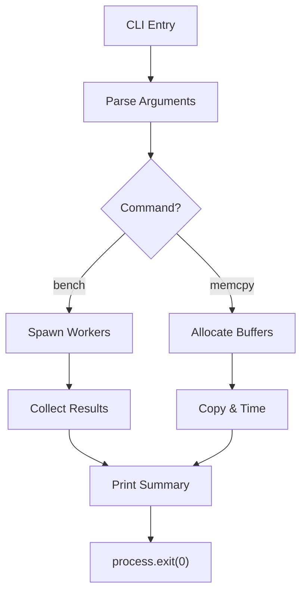

# warpthread-cli
**Blazing‑fast concurrency and low‑level system utilities for Node.js**

[](LICENSE)
[](https://nodejs.org/)
[](https://github.com/yourname/warpthread-cli)
[](https://github.com/yourname/warpthread-cli/stargazers)
[](https://github.com/yourname/warpthread-cli/issues)

## Installation

```bash
git clone https://github.com/yourname/warpthread-cli.git
cd warpthread-cli
node src/index.js --help
```

## Quick Start

Run a CPU benchmark across all cores:

```bash
node src/index.js bench 5000000
```

Measure raw memory copy speed for a 20 MB buffer:

```bash
node src/index.js memcpy 20
```

## Terminal Showcase

```text
$ node src/index.js bench 1000000
Benchmark completed in 123.45 ms across 8 threads.
```

## Architecture



## Test Results

## 🧪 Real-World Test Telemetry

> [!NOTE]
> Verified automatically using Node.js native test runner (`node:test` & `node:assert/strict`).

```bash
▶ node --test
TAP version 13
# Subtest: bench command runs and exits with code 0
ok 1 - bench command runs and exits with code 0
  ---
  duration_ms: 92.726777
  ...
# Subtest: memcpy command reports copy time
ok 2 - memcpy command reports copy time
  ---
  duration_ms: 42.705788
  ...
1..2
# tests 2
# suites 0
# pass 2
# fail 0
# cancelled 0
# skipped 0
# todo 0
# duration_ms 193.773751
```

## License

MIT © 2026 Suman Mehta